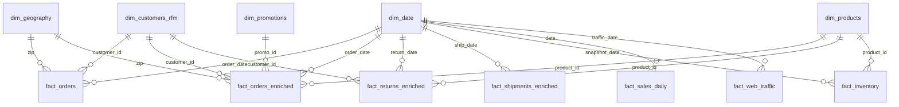

# Vin Datathon 2026 — E-commerce Dashboard & Analytics

> **Business Analytics Project | Power BI | SQL | Customer | Sales & Promotion | Inventory | Logistics & Returns**

An analysis of a **fashion e-commerce platform** over **2012–2022**, focused on identifying issues in **business performance, customer retention, sales, inventory, and logistics**, and turning them into recommendations that support data-driven decision-making.

## 📌 Dashboard Structure

> **Completed PBIP report:** open [`Sale Analytics1.pbip`](Sale%20Analytics1.pbip) in Power BI Desktop. The report contains five interactive pages and 46 DAX KPI measures in the semantic model's `_KPI` table. The Executive Overview uses yearly line trends for Revenue, Gross Profit, Gross Margin, Orders, AOV, and YoY Revenue Growth instead of single-value KPI cards.

The dashboard goes from overview to detail and is built around one KPI tree:

- **Revenue** = Sessions × Conversion Rate × AOV
- **Gross Profit** = Revenue × Gross Margin %

The Overview page shows which factor moved revenue (traffic, conversion, or AOV), and each later page digs into one of them.

| Page | Business question | Main content |
|---|---|---|
| **Executive Overview** | Is the business growing or shrinking, and why? | Six headline KPI trends by year, the KPI tree, 2012–2022 trend |
| **Customer Insights** | Do customers buy, and do they come back? | Registered → buyer funnel, cohort retention by first-order month, RFM segments from the segmentation part |
| **Product & Promotion** | Which products and categories drive revenue and profit, and do promotions pay off? | Category and margin, AOV and margin with vs. without a promotion |
| **Inventory** | Is stock in balance with demand? | Days of Supply (corrected formula), stockout/overstock, slow stock (DOS > 365 days) |
| **Logistics & Returns** | Do orders arrive, and do they stay? | Delivery time by region, return reasons, Wrong Size by product |

Report slicers support filtering the relevant analysis by date, product/category, order source, promotion, customer segment, demographics, inventory, and logistics attributes.

The PBIP project and its TMDL model are included in this folder. The source and processed datasets, as well as the large PBIX file, are intentionally excluded from GitHub. To refresh the model, run `python dashboard/prepare_powerbi_data.py` from the repository root after obtaining the input data, then update the `File.Contents` paths in the TMDL partitions to the location of the generated CSVs.

## 🧱 Data Processing & Data Model

The KPIs set what the model needs. [`prepare_powerbi_data.py`](prepare_powerbi_data.py) (Python + pandas) cleans, enriches, and reshapes the 13 raw CSV files into a **star schema**: 5 dimensions, 7 fact tables, and 3 pre-aggregated tables. Output goes to `data/processed/powerbi/`; Power BI imports it and handles the relationships and DAX measures.

```bash
python dashboard/prepare_powerbi_data.py   # ~1–2 min, 15 CSVs (~263 MB)
```

### Transformation steps

1. **Load** the 13 raw CSV files from `data/raw/` (read-only). Some files store dates as `dd/mm/yyyy` and others as `yyyy-mm-dd`; the script detects the format per column.
2. **Build dimensions:** a calendar table (`dim_date`); products with margin, average rating, and return rate; customers with region, RFM scores and labels, cohort month, and the K-Means segment from the segmentation part (if it has been run).
3. **Build facts, each at one grain:** orders (`fact_orders`: payment, shipping fee, refund, New vs Repeat flag), order lines (`fact_orders_enriched`: revenue, discount, cost, gross profit), returns, shipments (processing and delivery days, delivery bucket), daily sales (MA7/MA30, YoY), monthly inventory (stock value, health label), and daily web traffic (pages per session, conversion rate).
4. **Count revenue orders only for customer and conversion metrics:** RFM, cohort retention, New vs Repeat, and conversion rate use only `paid`, `shipped`, `delivered`, and `returned` orders, the same rule as the segmentation part. Fact tables keep every status, with an `is_revenue_order` flag, so the cancel rate can still be measured.
5. **Pre-aggregate** views that are slow or awkward in DAX: the monthly KPI rollup with MoM/YoY growth, the cohort retention matrix (months 0–24), and the rating trend by month × category.
6. **Model in Power BI:** mark `dim_date` as the date table; use one-to-many, single-direction relationships from dimensions to facts; keep the DAX KPI measures in the `_KPI` table. Set *Sort by column* for `month_name` (by `month`), `day_name` (by `day_of_week`), and `delivery_bucket` (by `delivery_bucket_order`).

### Star schema



Fact tables never link to each other (not even through `order_id`), and `dim_geography` does not link to `dim_customers_rfm` (which already carries `region` and `district`). Each filter therefore has exactly one path, so Power BI never hits an ambiguous-path error. Columns such as `order_status` and `is_revenue_order` are already on every fact table that needs them. The `agg_*` tables are already aggregated and stand alone, with no relationships.

### Output tables

| Type | File | 1 row = | Rows | Key fields |
|---|---|---|---:|---|
| Dim | `dim_date.csv` | 1 day | 4,018 | year, quarter, month, year_month, day_of_week, is_weekend |
| Dim | `dim_products.csv` | 1 SKU | 2,412 | category, segment, gross_margin_pct, avg_rating, return_rate_pct |
| Dim | `dim_customers_rfm.csv` | 1 customer | 121,930 | demographics, region, R/F/M scores, `rfm_segment`, cohort_month, K-Means segment |
| Dim | `dim_geography.csv` | 1 zip code | 39,948 | city, region, district |
| Dim | `dim_promotions.csv` | 1 promotion | 50 | promo_type, discount_value, validity period |
| Fact | `fact_orders.csv` | 1 order, every status | 646,945 | payment_value, shipping_fee, refund, New vs Repeat |
| Fact | `fact_orders_enriched.csv` | 1 order line, every status | 714,669 | line revenue / net revenue / cost / gross profit, discount_pct, has_promo |
| Fact | `fact_returns_enriched.csv` | 1 returned product | 39,939 | return_reason, days_to_return, days_after_delivery |
| Fact | `fact_shipments_enriched.csv` | 1 shipment | 566,067 | processing_days, delivery_days, delivery_bucket |
| Fact | `fact_sales_daily.csv` | 1 day | 3,833 | revenue, gross margin, MA7/MA30, YoY growth |
| Fact | `fact_inventory.csv` | 1 product per month | 60,247 | stock value (retail/cost), inventory_health |
| Fact | `fact_web_traffic.csv` | 1 day | 3,652 | sessions, pages_per_session, conversion_rate_pct |
| Agg | `agg_monthly_summary.csv` | 1 month | 126 | revenue, orders, customers, AOV, MoM / YoY growth |
| Agg | `agg_cohort_retention.csv` | 1 cohort × month offset | 2,423 | retention_rate for months 0–24 |
| Agg | `agg_reviews_summary.csv` | 1 month × category | 504 | avg_rating, % 5-star, % 1-star |

### Modeling decisions

- **Two fact grains for orders.** `payment_value` is order-level, so it lives only in `fact_orders`. Putting it on every order line would double-count orders with several products.
- **Two revenue definitions, kept apart.** `line_revenue` and `fact_sales_daily.revenue` are *before discount, every order status*; they reconcile exactly (16.43B). `line_net_revenue` and `payment_value` are *after discount*. Sales KPIs use net revenue from revenue orders.
- **Customers without a revenue order** are labelled `Never Purchased` (no order at all) or `No Converted Order` (every order cancelled or never paid).
- **Product and geography attributes come through relationships**, not duplicated columns, so the fact tables stay lean.
- **Known data issues from the EDA, handled in DAX:** refunds can exceed the amount paid (refunds are priced before discount), some shipped orders have no shipment record, and `reorder_flag` is constant. `traffic_source` holds one source per day and `bounce_rate` (0.3–0.6%) is implausibly low, so neither feeds a KPI.

## 📐 KPIs by Page

Sales KPIs (revenue, orders, AOV, margin, customers) count only orders that bring in revenue: `paid`, `shipped`, `delivered`, and `returned`. `created` and `cancelled` orders appear only in the cancel rate.

| Page | KPI | Formula |
|---|---|---|
| Executive Overview | Revenue | Sessions × Conversion Rate × AOV |
| Executive Overview | Gross Profit | Revenue × Gross Margin % |
| Executive Overview | Orders | Count of revenue orders (paid, shipped, delivered, returned) |
| Executive Overview | Customers | Count of buyers with a revenue order |
| Executive Overview | Conversion Rate (CR) | Orders ÷ Sessions |
| Executive Overview | YoY growth | (This year − Last year) ÷ Last year |
| Customer | Buyer rate | Customers with a completed order ÷ Registered customers |
| Customer | Repeat rate | Customers with 2+ orders ÷ Customers |
| Customer | Month +1 retention (cohort by first-order month) | Cohort buyers in month +1 ÷ Cohort size |
| Customer | LTV (Customer Lifetime Value) | Revenue ÷ Customers |
| Customer | Recency | Today − Last order date |
| Customer | RFM segment | K-Means on Recency, Frequency, Monetary |
| Sales & Promotion | AOV (Average Order Value) | Revenue ÷ Orders |
| Sales & Promotion | Gross Margin % | Gross profit ÷ Revenue |
| Sales & Promotion | Promo share | Promo orders ÷ Orders |
| Sales & Promotion | Promo AOV gap | AOV with promo − AOV without promo |
| Sales & Promotion | Discount rate | Discount amount ÷ Revenue before discount |
| Sales & Promotion | Cart size | Units sold ÷ Orders |
| Inventory | Days of Supply (DOS) | Stock on hand ÷ Avg daily units sold |
| Inventory | Receive-to-Sales ratio | Units received ÷ Units sold |
| Inventory | Stockout rate | Out-of-stock product-months ÷ All product-months |
| Inventory | Overstock rate | Overstocked product-months ÷ All product-months |
| Inventory | Sell-through | Units sold ÷ Units available |
| Inventory | Slow stock | Stock with DOS > 365 days ÷ Stock on hand |
| Logistics & Returns | Delivery days | Avg (Delivery date − Order date) |
| Logistics & Returns | Order-to-ship days | Avg (Ship date − Order date) |
| Logistics & Returns | Cancel rate | Cancelled orders ÷ All orders placed |
| Logistics & Returns | Return rate | Returned orders ÷ Delivered orders |
| Logistics & Returns | Wrong Size share | Wrong Size returns ÷ All returns |

> **Why two KPIs changed:** sign-up dates cannot be trusted (73.8% of orders are dated before the customer's sign-up), so the funnel counts registered customers who bought, and cohorts start at the first order. The inventory file has no receipt dates, so true stock age cannot be measured; slow stock uses Days of Supply instead.

> The findings below come from version 1 of the dashboard and the EDA. They will be re-checked once the rebuilt dashboard is done.

## 📊 Dataset Overview

The dataset simulates a fashion e-commerce business in Vietnam. It contains **15 CSV files** covering the main operating period from **July 4, 2012 to December 31, 2022**, organized into four groups:

- **Master — reference data:** `products`, `customers`, `promotions`, and `geography`.
- **Transaction — business transactions:** `orders`, `order_items`, `payments`, `shipments`, `returns`, and `reviews`.
- **Analytical — analysis:** `sales` and `sample_submission`.
- **Operational — operations:** `inventory`, `inventory_enhanced`, and `web_traffic`.

Together, the files cover the business journey from customers and products through orders, payments, shipping, returns, and reviews. They also include promotion and geographic details, monthly inventory snapshots, and daily website traffic. This supports analysis of sales and profitability, customer behavior, promotion performance, inventory management, logistics, and traffic sources.

The tables are primarily linked by identifiers such as `customer_id`, `product_id`, `order_id`, `promo_id`, and postal code `zip`. Their levels of detail differ: orders are recorded at the transaction level, `order_items` at the product-line level, inventory at the product-month level, and website traffic at the daily level. These differences should be considered when joining tables to avoid double-counting.

For sales forecasting, the training period runs from **July 4, 2012 to December 31, 2022**, and the test period runs from **January 1, 2023 to July 1, 2024**. The target is `Revenue`.

### Business Questions

The project focuses on answering the following questions:

- Is the business growing or declining?
- What are the main drivers behind the decline in revenue and orders?
- Do customers come back to make repeat purchases?
- Which categories and channels generate the most value?
- Is the business facing inventory issues?
- What factors are affecting returns and delivery performance?
- Which areas should the business prioritize improving first?

---

# 🔍 Key Business Insights

## 1. Executive Overview — Business Performance

### 🔎 Key Findings

- The business peaked on its main KPIs around **2016**; revenue, orders, and customer count then declined steadily through **2022**.
- **Revenue CAGR is about -3.8% per year**, showing the business is contracting rather than growing.
- Profit margin fell from about **22% to 14%**, reflecting weakening business efficiency.
- Sessions grew **63%** from 2013 to 2022, but the **conversion rate (revenue orders ÷ sessions) fell from 1.01% to 0.29%**, so the problem is not just attracting traffic but converting visitors into customers.

### 💡 Business Implications

The business is facing a **conversion and customer retention** problem, not simply a lack of traffic.

In particular, acquisition relies heavily on **organic search and paid channels**, while retention-friendly channels such as **email and referral** remain underused.


---

# 2. Customer — Customer Behavior & Retention

### 🔎 Key Findings

- **28% of registered customers (34,091) never completed an order**, meaning a large share of users drop out of the funnel before becoming customers.
- **Registrations keep rising while purchases decline**, widening the gap between registered users and paying customers. Low customer conversion is the main bottleneck in the funnel.
- Nearly **48% of the customer base is Never Purchased or Lost**.
- Retention drops sharply from **Month +1**, showing the business lacks strong mechanisms to drive repeat purchases.
- A large share of customers has high Recency, signaling churn risk.

### 💡 Recommendations

**1. Improve First Purchase Conversion**

- Offer **15% discount + Free Shipping** on the first order.
- Design an onboarding flow for new users.
- Trigger an email/voucher **24 hours** after sign-up if the user has not purchased.

**2. Improve Customer Retention**

- Send personalized offers after **30 days without a purchase**.
- Build customer segmentation based on **RFM**.
- Launch a **VIP Tier Program** for high-value customers.

**3. Focus on High-value Customers**

Prioritize customer groups with:

- High Monetary Value
- High Purchase Frequency
- Low Recency


---

# 3. Sales & Promotion — Revenue, Profitability & Promotions

### 🔎 Key Findings

- Revenue reached about **15.7 billion VND** across the dataset.
- Streetwear is the largest category, contributing about **80% of profit**, which creates dependency on a single category.
- **Promotions appear on about 38% of orders**, yet AOV tends to drop in many categories when promotions are used.
- Customers aged **25–44** are one of the most important groups to prioritize.

### 💡 Recommendations

**1. Improve Promotion Efficiency**

Instead of blanket discounts:

- Set a minimum order value.
- Use combo pricing.
- Apply personalized promotions.
- Enforce a discount floor to protect margin.

**2. Increase Customer Value**

Focus on:

- Cross-selling
- Upselling
- Product bundling

for customers with high purchase frequency and AOV.

**3. Reduce Category Concentration Risk**

- Keep growing Streetwear without becoming over-reliant on it.
- Expand **Outdoor** if the category shows growth potential.
- Re-evaluate **Casual** performance and adjust assortment/pricing.


---

# 4. Inventory — Inventory Efficiency

### 🔎 Key Findings

The business is facing a **supply-demand imbalance**:

- **Days of Supply (DOS) reaches ~826 days**.
- Inventory replenishment exceeds actual demand.
- The inventory-to-sales ratio stays around **1.15–1.18**.
- This increases the risk of:
  - Capital being tied up
  - Overstock
  - Inventory aging
  - Markdown pressure

### 💡 Recommendations

#### Short-term — Liquidate Excess Inventory

- Flash Sale
- Markdown
- Clearance Campaign

Goal: quickly recover part of the capital tied up in stock.

#### Medium-term — Bundle

Combine:

> Slow-moving products + Best-selling products

to move excess stock without deep discounting.

#### Long-term — B2B / Wholesale

For products with high inventory aging:

- Wholesale
- B2B liquidation
- Outlet channels

can be used to clear inventory faster.


---

# 5. Logistics & Returns — Delivery & Returns

### 🔎 Key Findings

- Average delivery time is about **6 days**, leaving room to improve the delivery experience.
- **Wrong Size** is one of the most common return reasons.
- Size-related returns not only hurt customer experience but also increase:
  - Reverse logistics cost
  - Inventory handling cost
  - Delivery workload

### 💡 Recommendations

**1. Improve Size Selection**

- Design a clearer, more visual Size Guide.
- Add model height/weight.
- Provide fit information: Slim / Regular / Oversized.
- With enough data, build size recommendations based on customer profiles.

**2. Improve Delivery Performance**

- Adopt a **Multi-carrier Strategy**.
- Compare carriers by:
  - Delivery Time
  - On-time Delivery Rate
  - Return Rate
  - Cost per Order


---

# 📊 Key Business Findings

| # | Finding | Business Implication |
|---|---|---|
| 01 | Revenue CAGR ≈ **-3.8%** | Business has entered a declining growth phase |
| 02 | Margin declined from **~22% → ~14%** | Profitability is deteriorating |
| 03 | **~48% customers** are Never Purchased or Lost | Customer retention is a major issue |
| 04 | Retention drops significantly from **Month +1** | Weak post-purchase engagement |
| 05 | Promotion applied to **~38% orders** | Discount strategy may be hurting AOV |
| 06 | Streetwear contributes **~80% of profit** | High category concentration risk |
| 07 | DOS reaches **~826 days** | Severe overstock / capital inefficiency |
| 08 | Wrong Size is a major return reason | Opportunity to improve product information |
| 09 | Organic Search & Social Media have high volume but lower AOV | Acquisition efficiency should be optimized |
| 10 | Email has higher AOV but lower volume | Potential opportunity for targeted CRM investment |
| 11 | Registrations keep rising while purchases decline | Low customer conversion: new users are not turning into buyers |

---

# 🎯 Recommended Business Priorities

Priorities are ranked by **impact on revenue/profit** and **speed of implementation**. Each priority covers the problem (based on the findings), specific actions, owner, timeline, and KPIs to track.

> **Note:** Targets are **proposals** based on baselines in the dataset and should be validated through A/B tests or monthly tracking before being formally adopted. KPIs marked *"Measure from dashboard"* do not yet have a specific baseline and need one established before rollout.

### 🗺️ Roadmap Summary

| Priority | Core Problem | Key Actions | North-star KPI | Proposed Target |
|---|---|---|---|---|
| 1️⃣ Conversion & Retention | Registrations up but purchases down · 28% of registered customers never completed an order · ~48% Never Purchased/Lost | Funnel fix + welcome flow + RFM-based win-back | % Never Purchased/Lost customers | **48% → 40%** in 12 months |
| 2️⃣ Inventory Efficiency | DOS ~826 days · Inventory/Sales 1.15–1.18 | Stop replenishing aged SKUs + liquidate by inventory age | Days of Supply | **826 → < 365 days** in 12 months |
| 3️⃣ Promotion & Margin | Promotions on ~38% of orders · Margin 22% → 14% | Targeted promotions + discount floor | Gross Margin | **14% → 18%** in 12 months |
| 4️⃣ Revenue Diversification | Streetwear ~80% of profit | Expand Outdoor + grow the Email channel | % of profit from Streetwear | **80% → ≤ 70%** in 12 months |
| 5️⃣ Logistics & Returns | Delivery ~6 days · Wrong Size is a top return reason | Standardized size guide + carrier scorecard | Average Delivery Time | **6 → 4 days** in 6 months |

---

### 1️⃣ Improve Customer Conversion & Retention

**Why priority #1:** **Registrations are rising while purchases are falling**, meaning the business still attracts new users but fails to turn them into buyers. Sessions grew 63% from 2013 to 2022, yet conversion fell from **1.01% to 0.29%**, **28%** of registered customers never completed an order, and retention drops sharply from **Month +1**. The business is losing customers at both ends of the funnel: it cannot convert new users or keep existing buyers.

| # | Action | Implementation Details | Owner | Timeline |
|---|---|---|---|---|
| 1.1 | **Find funnel drop-off points** | Analyze the **Sign-up → Product View → Add to Cart → Checkout → Payment** funnel by monthly sign-up cohort to find the step losing the most users, and fix that step first. | Data / E-commerce | Month 1 |
| 1.2 | **Abandoned cart reminders** | Send email/push at **1h** and **24h** to users who added items to cart but did not pay, with product images and free-shipping info. | CRM | Month 1 |
| 1.3 | **Welcome flow for new users** | Email/push **24h** after sign-up if no purchase: **15% + Free Shipping** voucher, valid for 7 days. Second reminder after 72h. | CRM / Marketing | Month 1 |
| 1.4 | **Post-purchase journey** | Emails on day **+7** (styling tips, related products) and day **+21** (second-order voucher) to carry customers past the Month +1 drop. | CRM | Months 1–2 |
| 1.5 | **Recency-based win-back** | Automated triggers at **30 / 60 / 90 days** without a purchase, with escalating offers. After 90 days with no response, move to Lost and reduce send frequency. | CRM | Months 2–3 |
| 1.6 | **Monthly RFM segmentation** | Refresh RFM monthly in Power BI and map each segment to its own campaign (Champions → early access, At Risk → win-back, Hibernating → reactivation). | Data / CRM | Month 2 |
| 1.7 | **VIP Tier Program** | For the **top 10% of customers by Monetary value**: unlimited free shipping, early sale access, birthday gifts. | Marketing | Months 4–6 |

| KPI | Baseline | Proposed Target |
|---|---|---|
| Registered customers who never completed an order | 28% | Downward trend across monthly sign-up cohorts |
| First purchase within 30 days of sign-up | Measure from dashboard | Steady increase across monthly cohorts |
| Purchase growth vs. registration growth | Registrations up, purchases down | Purchases grow in line with registrations |
| Never Purchased + Lost | ~48% | **≤ 40%** after 12 months |
| Conversion Rate (revenue orders ÷ sessions) | 0.29% (2022) | Steady month-over-month increase |
| Month +1 Retention | Measure from dashboard | **+5 percentage points** vs. baseline |
| Repeat Purchase Rate / CLV | Measure from dashboard | Quarter-over-quarter growth |

---

### 2️⃣ Improve Inventory Efficiency

**Why priority #2:** A DOS of **~826 days** means current stock would last more than 2 years, while the inventory-to-sales ratio stays at **1.15–1.18**. Capital is locked in inventory and markdown pressure will keep growing.

| # | Action | Implementation Details | Owner | Timeline |
|---|---|---|---|---|
| 2.1 | **Classify SKUs by inventory age** | Split SKUs into 4 groups: **< 90 days / 90–180 / 180–365 / > 365 days**, combined with ABC analysis by revenue. This feeds every action below. | Data / Merchandising | Month 1 |
| 2.2 | **Stop replenishing aged SKUs** | Pause replenishment for SKUs with **DOS > 365 days**. Set reorder points from a **90-day** demand forecast instead of habitual ordering. | Supply Chain | Months 1–2 |
| 2.3 | **Liquidate by inventory age** | 180–365 days: **flash sale / 20–30% markdown**. Over 365 days: **clearance campaign**. | Merchandising / Marketing | Months 2–4 |
| 2.4 | **Bundle slow movers with best-sellers** | Pair 1 slow-moving SKU with 1 best-seller in the same category, discounting the bundle total rather than each item to protect best-seller pricing. | Merchandising | Months 3–6 |
| 2.5 | **B2B / Outlet channels** | Stock still over 365 days after clearance: move to wholesale, B2B liquidation, or outlet. | Sales / Ops | Months 6–12 |

| KPI | Baseline | Proposed Target |
|---|---|---|
| Days of Supply | ~826 days | **< 500 days** after 6 months · **< 365 days** after 12 months |
| Inventory-to-Sales Ratio | 1.15–1.18 | **≤ 1.0** |
| % SKUs aged > 365 days | Measure from dashboard | **50%** reduction after 12 months |
| Stockout Rate (best-sellers) | Measure from dashboard | No increase while cutting replenishment |

---

### 3️⃣ Improve Promotion & Margin

**Why priority #3:** Promotions appear on **~38% of orders**, yet AOV drops in many categories when promotions are used, while margin has already fallen from **~22% to ~14%**. Blanket discounting is eroding profit without increasing order value.

| # | Action | Implementation Details | Owner | Timeline |
|---|---|---|---|---|
| 3.1 | **Minimum order value** | Apply vouchers only to orders **≥ current AOV + 15–20%**, so promotions push AOV up instead of down. | Marketing | Month 1 |
| 3.2 | **Discount floor by category** | Cap discounts so post-discount margin stays **≥ 10%**; promotions above the cap require separate approval. | Finance / Merchandising | Months 1–2 |
| 3.3 | **Targeted instead of mass discounts** | Reserve deep offers for segments that need activation (At Risk, New), not for Champions who already buy regularly. | CRM | Months 2–3 |
| 3.4 | **Combo pricing & cross-sell** | Outfit combos (top + bottom + accessory) for high-frequency, high-AOV customers, especially those aged **25–44**. | Merchandising | Months 3–6 |
| 3.5 | **Measure Promotion ROI with a holdout** | Keep **10% of customers out of promotions** as a control group to measure the true incremental revenue of each campaign. | Data | Ongoing |

| KPI | Baseline | Proposed Target |
|---|---|---|
| % of orders with promotion | ~38% | **≤ 25%** after 6 months |
| Gross Margin | ~14% | **≥ 18%** after 12 months |
| AOV with vs. without promotion | Measure from dashboard | Narrow the gap |
| Promotion ROI | Not yet measured | Every campaign shows positive ROI vs. holdout |

---

### 4️⃣ Diversify Revenue Sources

**Why priority #4:** Streetwear generates **~80% of profit**, so any slowdown in this category hits total profit directly. On the channel side, Organic Search & Social Media bring high volume but low AOV, while **Email has high AOV but low volume**.

| # | Action | Implementation Details | Owner | Timeline |
|---|---|---|---|---|
| 4.1 | **Expand Outdoor** | Increase Outdoor assortment and ad budget if quarterly growth is positive; pilot with 10–20 new SKUs first. | Merchandising | Months 2–6 |
| 4.2 | **Restructure Casual** | Review the lowest-margin Casual SKUs, cut underperformers, and adjust pricing. | Merchandising | Months 3–4 |
| 4.3 | **Cross-sell from Streetwear** | Use Streetwear's large customer base to introduce Outdoor/Casual through "complete the look" suggestions on product pages and in emails. | Marketing / E-commerce | Months 2–4 |
| 4.4 | **Scale the Email channel** | Capture emails at checkout and on site (offer pop-ups), and shift part of the paid budget to CRM/Email and Referral. | Marketing | Months 1–6 |
| 4.5 | **Track CAC & AOV by channel** | Monthly report on CAC, AOV, and repeat rate per channel to reallocate budget by efficiency. | Data / Marketing | Month 1 |

| KPI | Baseline | Proposed Target |
|---|---|---|
| % of profit from Streetwear | ~80% | **≤ 70%** after 12 months |
| Outdoor revenue growth | Measure from dashboard | Positive quarter-over-quarter growth |
| % of revenue from Email | Measure from dashboard | **Double** after 12 months |
| CAC by channel | Measure from dashboard | Lower blended CAC |

---

### 5️⃣ Improve Logistics & Return Experience

**Why priority #5:** Average delivery time is **~6 days** and **Wrong Size** is a leading return reason. Every size-related return adds reverse logistics and inventory handling cost, and lowers the chance the customer comes back.

| # | Action | Implementation Details | Owner | Timeline |
|---|---|---|---|---|
| 5.1 | **Prioritize SKUs with high Wrong Size returns** | List the **top 20 SKUs** by Wrong Size returns and re-measure their actual size charts first. | Data / Product | Month 1 |
| 5.2 | **Detailed size guide** | Measurements in **cm**, model height/weight, and **Slim / Regular / Oversized** fit labels on every product page. | E-commerce / Product | Months 1–3 |
| 5.3 | **Size recommendation** | Suggest sizes from each customer's purchase and return history (once enough data is available). | Data | Months 6–12 |
| 5.4 | **Carrier scorecard** | Compare carriers monthly on **delivery time, on-time rate, return rate, cost per order**; shift volume to the best carrier in each region. | Ops / Logistics | Months 2–3 |
| 5.5 | **Regional multi-carrier setup** | Contract at least 2 carriers per major region for backup capacity and competitive pressure on SLAs. | Ops | Months 3–6 |

| KPI | Baseline | Proposed Target |
|---|---|---|
| Average Delivery Time | ~6 days | **≤ 4 days** after 6 months |
| Wrong Size returns | Measure from dashboard | **20–30%** reduction after 6 months |
| On-time Delivery Rate | Measure from dashboard | **≥ 95%** |
| Cost per Shipment | Measure from dashboard | No increase while cutting delivery time |

---

# 🛠️ Tools & Technologies

- **Power BI** — Dashboard & Data Visualization
- **Python** — Data Querying & Transformation
- **Excel** — Data Exploration & Validation
- **DAX** — KPI Calculation & Business Metrics
